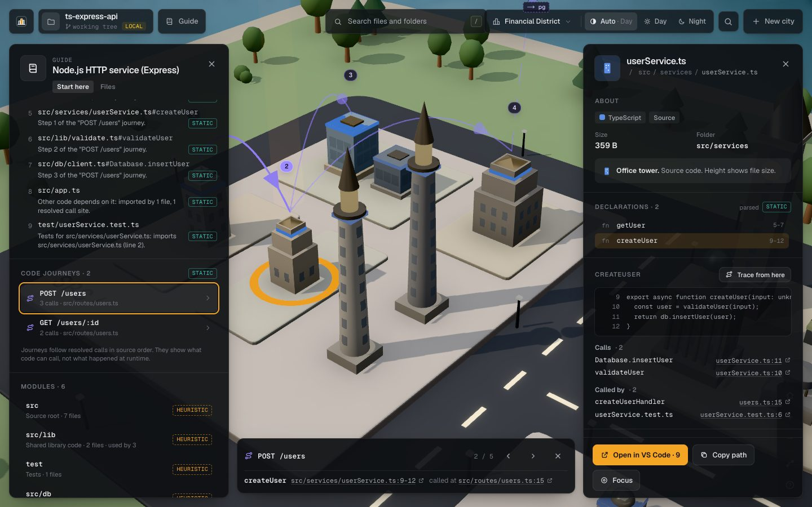
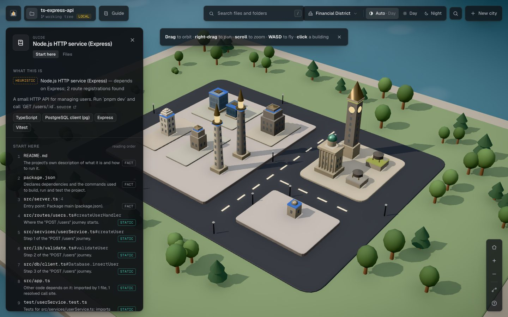

# CodeScape

**Understand any codebase. Find your way around.**

When you join a project, inherit a legacy system or open an unfamiliar repository, the first days go into rebuilding its mental model by hand. You have to work out:

- what this is;
- where execution enters;
- which modules matter;
- how a request actually gets to the database;
- where to start reading.

CodeScape answers those questions from the code itself, and shows the answers on an explorable 3D map of the repository. It works three ways:

- **In the browser**, for any public GitHub repository.
- **Locally**, for your checked-out repository, private code and uncommitted changes included. Nothing leaves your machine.
- **Inside Claude Code**, through MCP. For a public repository, copy one command from the map (no install); for private code, run the server on your machine. Claude can then answer "how does this work?" with `path:line` evidence and send you a link to the exact spot in the map.



## What you get

- **An overview from evidence.** You see the project type, technologies, modules and their likely roles, entry points, routes, and run and test commands. Each item is labelled **fact** (read from files or manifests), **static analysis** (parsed and resolved from source) or **heuristic** (inferred from names). CodeScape never presents a guess as a fact.
- **A reading order with reasons.** "Start with the README, then `package.json` (declares the commands), then `src/server.ts` (package main), then the 'POST /users' journey…"
- **Code journeys.** CodeScape follows an operation from where it enters the code (an HTTP route, a page, `main`) through resolved calls to where it leaves the repository (`pool.query` in `pg`). It draws the journey as numbered stops across the city, and you step through it with `[` and `]`. Where static analysis can't follow, such as dynamic dispatch or an unresolved handler, the journey shows a gap instead of inventing a step.
- **Source-backed inspection.** Click a building to see its declarations with line ranges, a redacted source excerpt, calls, callers, packages used, routes and related tests. "Open in VS Code" (or on GitHub) takes you to the exact line.
- **Search** across files, folders and declarations, plus a keyboard-navigable file tree.
- **Deep links.** `?select=src/db/client.ts&symbol=…&journey=…` reopens exactly what you were looking at.
- **City styles and time of day.** Four architectural styles, plus Auto, Day and Night lighting. They change only the look; the data and positions stay the same.

## Quick start

Requires Node 22 (see `.nvmrc`; 20.9 or later works) and pnpm 10.

```bash
pnpm install
pnpm build
pnpm build:cli
```

**Explore a public GitHub repository:** run `pnpm dev`, open http://localhost:3000 and paste a repository URL.

**Explore a local or private repository:**

```bash
node dist/cli.mjs view --root /path/to/your/repo --open
```

**Use it from Claude Code with a public repository:** open the repository's city, click its name, and copy the command under **Ask Claude about it**. It looks like this (use your deployment's address, or `http://localhost:3000` while running `pnpm dev`):

```bash
claude mcp add --transport http codescape-flask "https://<your-codescape-site>/api/mcp/pallets/flask"
```

**Use it from Claude Code with a local or private repository**, inside that repository:

```bash
claude mcp add codescape -- node /absolute/path/to/codescape/dist/cli.mjs mcp
```

Then ask Claude, for example: *"I just joined this project. How does a POST /users request reach the database? Show me in CodeScape."* For the tools, prompts, configuration and troubleshooting, see **[docs/MCP.md](docs/MCP.md)**.

Print the analysis without any UI:

```bash
node dist/cli.mjs analyze --root /path/to/repo
```



## Reading the city

| What you see | What it means | How it's known |
| --- | --- | --- |
| District | A folder. Top-level folders are labelled on the ground. | Fact |
| Building | A file. Very large folders may be drawn as a single block. | Fact |
| Height | File size on a log scale. Compare heights between buildings of the same shape. | Fact |
| Shape | The file's role: source, test, config, build, docs, style, data or asset. | Heuristic (name and extension) |
| Landmarks | README, manifest, licence and entry points. An entry point is either confirmed (manifest, route, `main`) or named like one, and the inspector says which. | Fact / heuristic |
| Amber and teal arcs | Imports out of and into the selected building, drawn only when an import resolves to a real file. | Static analysis |
| Violet numbered route | A code journey. A dashed line rising out of a building is a call into a package. | Static analysis |
| Windows, streetlights, trees | Decoration only. Nothing in the city implies runtime traffic. | — |

Press `?` in the app for the full legend and shortcuts.

## What runs where

- **GitHub mode** runs entirely in your browser. It reads the file tree through GitHub's public API (about 2 requests per city), and fetches at most 300 source files from `raw.githubusercontent.com` to parse them.
- **The hosted MCP endpoint** (`/api/mcp/<owner>/<repo>`) does what GitHub mode does, on the server: it reads one public repository from GitHub (at most 600 source files), keeps the analysis in memory for 15 minutes, and stores nothing else.
- **Local mode and the local MCP server** read files from your disk, and only inside the folder you choose. Symlinks that point outside it, likely secret files (`.env*`, keys, credentials) and binaries are never read, and returned text is redacted. Repository code is never executed, and neither is `git`: branch and commit are read from `.git` files. The local viewer only answers requests to `127.0.0.1` / `localhost`.

See [SECURITY.md](SECURITY.md) for the full model.

## How it works

```
src/lib/analysis/   the shared engine
                    (file tree → model → tree-sitter parse → imports, calls, journeys, overview, onboarding)
src/lib/local/      Node only: safe filesystem access, .gitignore-aware walk, git revision, caching and freshness
src/mcp/            the MCP server: seven read-only tools, one resource, two prompts (stdio locally, HTTP when hosted)
src/lib/remote/     Node only: a public GitHub repository analysed on the server, for the hosted MCP endpoint
src/cli/            the `codescape` command: mcp, view, analyze, and the viewer launcher
src/app/api/        the hosted MCP endpoint (api/mcp), and localhost-only routes the viewer uses for local repositories
src/components/     the React Three Fiber city and the interface
```

The browser, the local viewer and the MCP server all call the same `analyzeRepository()`, so the map and Claude always agree. For more, see [docs/ARCHITECTURE.md](docs/ARCHITECTURE.md).

## Deploying

The website and the hosted MCP endpoint deploy together as one Next.js app, for example on Vercel. Set `GITHUB_TOKEN` so the server isn't limited to GitHub's 60 anonymous requests an hour. See **[docs/DEPLOY.md](docs/DEPLOY.md)**.

## Development

```bash
pnpm dev          # web app on :3000 (copies the tree-sitter WASM files to public/wasm first)
pnpm test         # Vitest: engine, local safety, MCP contract and stdio transport (builds the CLI first)
pnpm test:e2e     # Playwright against the production build (run `pnpm build` first)
pnpm typecheck
pnpm lint
pnpm build        # production web build
pnpm build:cli    # dist/cli.mjs
```

To work on local mode, run the dev server with `CODESCAPE_ROOT=test/fixtures/ts-express-api pnpm dev` and open `/local`.

Contributors and coding agents should read [CONTRIBUTING.md](CONTRIBUTING.md) and keep the three work logs current:

- [EXECUTION.md](EXECUTION.md): what was done;
- [LEARNINGS.md](LEARNINGS.md): problems already solved;
- [INTERFACE.md](INTERFACE.md): design decisions to follow.

## Limits

- **Languages.** Parsing covers JavaScript, TypeScript, Python, Go, Rust and Java. Other languages (Kotlin, C#, Ruby, PHP and so on) appear in the map without symbols or edges.
- **Static analysis only.** Dynamic dispatch, reflection and string-based routing aren't followed, and journeys show those points as gaps. In Rust and Java, a call is followed through a parameter, local or field only when its type is declared in the source, so constructor-injected Spring services are traced, but a call on an interface or trait stops at its declaration.
- **Caps.** Large repositories hit the parse caps (300 files in the browser; 4,000 files or 40 MB locally). The overview always lists what was left out.
- **Runtime behaviour.** No runtime data is used yet: no traces, latency or errors.

## License

[MIT](LICENSE). Third-party components keep their own licences:

- Geist and Geist Mono fonts (SIL Open Font License 1.1);
- the tree-sitter grammars (MIT);
- the MCP TypeScript SDK (Apache-2.0).
